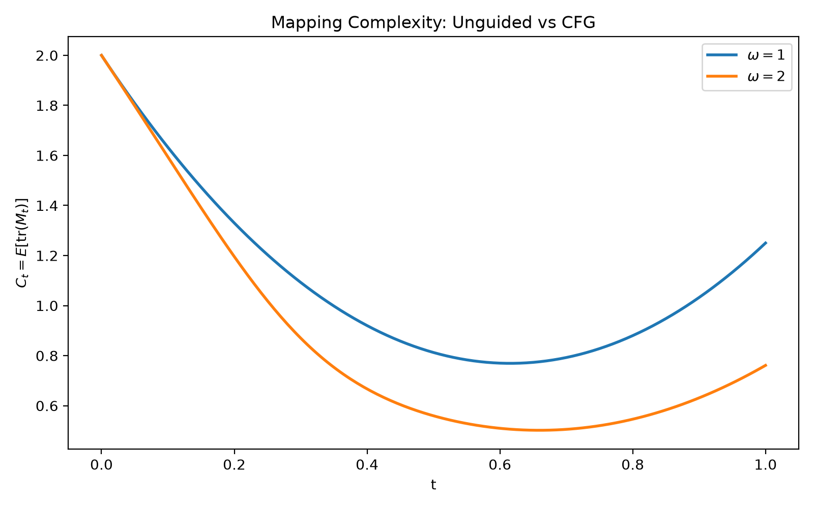
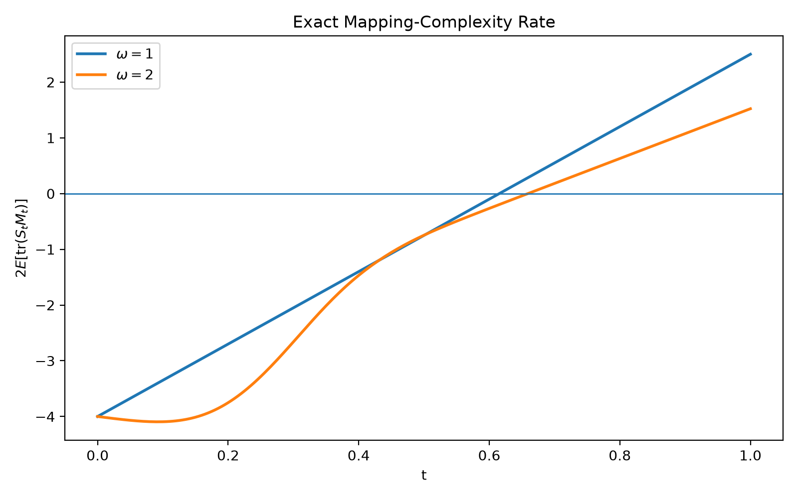
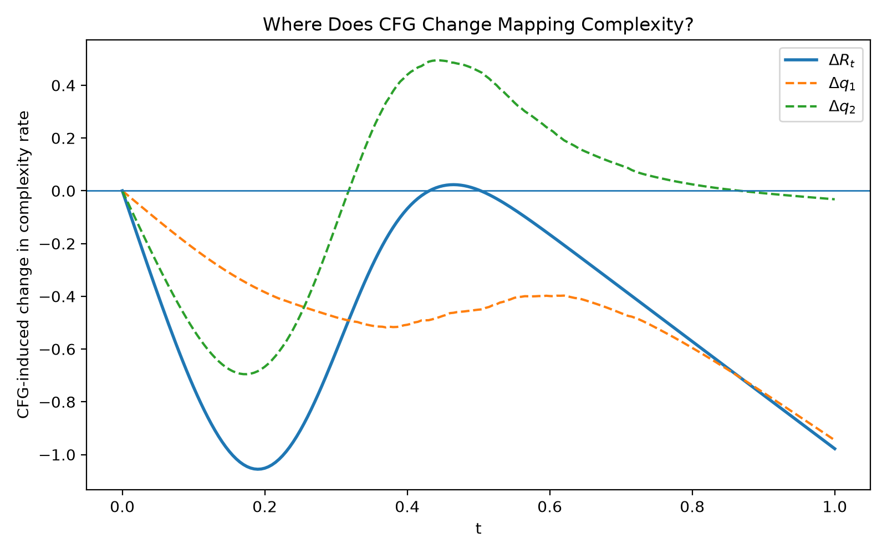

# Mapping Complexity over the CFG Family

A compact 2D toy study of **how classifier-free guidance (CFG) changes flow-map geometry and mapping complexity**.

neural velocity estimation error가 없는 analytic toy setting에서 CFG 자체가 flow map의 geometry를 어떻게 바꾸고 mapping complexity를 왜 감소시키는지 단계적으로 확인한 프로젝트입니다.

---

## Question / 핵심 질문

We measure flow-map complexity by

$$
\mathcal{C}(f)=\mathbb{E}_z[\|\nabla f(z)\|_F^2].
$$

The initial hypothesis was **CFG → contraction → lower mapping complexity**.

즉, **CFG가 induced re-mapping을 contraction시키기 때문에 더 단순한 flow map을 만드는가?** 에서 출발했습니다.

---

## Experiment Flow / 실험 흐름

### Exp1 — Does CFG induce contraction?

We studied the CFG-induced re-mapping

$$
g_\omega=f^{(\omega)}\circ f^{-1}.
$$

**Result:** CFG produced clear directional contraction, but one direction remained unchanged.

**Meaning / 의미:** contraction intuition은 맞는 방향이었지만 strict full-space contraction은 아니었습니다.

→ 그래서 anisotropic target에서 contraction을 다시 확인하는 **Exp2**로 진행했습니다.

### Exp2 — Can CFG produce strict local contraction?

**Result:** after introducing anisotropic class covariances, sampled local operator norms became smaller than 1 for $\omega>1$.

**Meaning:** CFG가 local contraction을 만들 수 있음을 확인했습니다. 다만 sampled local result이며 global contraction의 증명은 아닙니다.

→ 다음으로 **contraction이 실제 mapping complexity 감소로 이어지는지** Exp3에서 직접 측정했습니다.

### Exp3 — Does CFG reduce mapping complexity?

We measured

$$
\mathcal{C}(f^{(\omega)})=\mathbb{E}_z[\|\nabla f^{(\omega)}(z)\|_F^2].
$$

| CFG scale $\omega$ | Complexity |
|---:|---:|
| 1.0 | 1.2500 |
| 1.5 | 0.8957 |
| 2.0 | 0.7611 |
| 3.0 | 0.6376 |
| 4.0 | 0.5768 |

**Result:** CFG substantially reduced mapping complexity even with analytic velocity fields and no neural velocity estimator.

**Meaning:** 이 toy에서 CFG의 이득은 neural velocity estimation error만으로 설명되지 않습니다. CFG 자체가 flow-map geometry를 단순화하고 있었습니다.

→ 하지만 operator-norm contraction만으로 이 감소를 설명할 수 있는지 확인하기 위해 directional diagnostics와 **Exp4**로 진행했습니다.

### Exp4 — Is global contraction necessary?

**Result:** some samples expanded in one direction while total Frobenius mapping complexity still decreased.

**Meaning:** 모든 방향이 contraction될 필요는 없었습니다. 각 방향의 변화뿐 아니라 reference flow가 그 방향에 가지고 있던 deformation energy도 중요했습니다.

→ 따라서 endpoint contraction보다 **시간에 따라 deformation이 어떻게 누적되는지**를 분석하게 되었습니다.

### Pre-Exp5 — What controls complexity over time?

Let $J_t$ be the flow Jacobian, $M_t=J_tJ_t^\top$, and let $S_t$ be the symmetric part of the velocity Jacobian. Then

$$
\frac{d}{dt}\mathcal{C}_t
=
2\mathbb{E}[\mathrm{tr}(S_tM_t)].
$$

**Result:** complexity first decreased and then partially re-expanded. A single dominant deformation direction was not enough to explain the total change.

**Meaning:** complexity는 현재 velocity gradient만으로 결정되지 않고, **instantaneous signed stretching ($S_t$)** 과 **accumulated deformation geometry ($M_t$)** 의 상호작용으로 결정됩니다.

→ 이 설명의 경계를 확인하기 위해 **Exp5**에서 path, transport, velocity summaries를 분리해서 테스트했습니다.

### Exp5 — What information is sufficient?

- **Exp5-A:** rotating linear-Gaussian paths had the same final complexity because the endpoint covariance structurally fixed it.
- **Exp5-B:** the **same marginal probability path** with different transport couplings produced different final complexities.
- **Exp5-C:** simple velocity-only summaries did not reliably reproduce true complexity ordering.
- **Exp5-D:** changing the intermediate probability path did **not necessarily** change final complexity in the tested family.

**Meaning:** endpoint, marginal path, 또는 단순한 scalar velocity statistic만으로 final mapping complexity를 일반적으로 설명할 수 없었습니다. 실제 **transport/deformation history**가 중요하다는 쪽으로 결론이 좁혀졌습니다.

→ 마지막으로 이 exact deformation mechanism이 실제 CFG의 차이를 직접 설명하는지 **Exp6**에서 확인했습니다.

### Exp6 — Direct CFG mechanism test

We compared $\omega=1$ and $\omega=2$ using

$$
R_t=2\mathbb{E}[\mathrm{tr}(S_tM_t)].
$$

Final complexity:

- $\omega=1$: **1.2500**
- $\omega=2$: **0.7611**

The observed difference was approximately **-0.48887**, and the time-integrated difference in the exact rates matched it up to numerical integration error.

**Result:** CFG was not more contractive at every instant. Instead, it produced **stronger early complexity decrease + delayed/weaker late re-expansion**.

**Meaning:** CFG의 최종 complexity 감소는 uniform contraction이 아니라, 전체 시간에 걸쳐 달라진 deformation history의 누적 결과였습니다.

---

## Final Picture / 최종 결론

**contraction hypothesis**  
→ **directional contraction**  
→ **direct complexity reduction**  
→ **global contraction is insufficient**  
→ **exact deformation dynamics**  
→ **path/transport boundary tests**  
→ **direct CFG mechanism validation**

The central identity is

$$
\boxed{
\frac{d}{dt}\mathcal{C}_t
=
2\mathbb{E}[\mathrm{tr}(S_tM_t)]
}
$$

where $S_t$ is instantaneous signed stretching and $M_t$ is accumulated deformation geometry.

> In this analytic 2D toy, CFG genuinely reduces flow-map mapping complexity independently of neural velocity-estimation error. The effect is not explained by uniform contraction, but by the time-dependent interaction between instantaneous stretching and accumulated deformation.

> 이 analytic 2D toy에서 CFG는 neural velocity estimation error와 독립적으로 flow-map complexity를 실제로 감소시켰습니다. 그 메커니즘은 단순한 uniform contraction이 아니라, **순간적인 signed stretching과 누적된 deformation geometry의 시간적 상호작용**으로 설명됩니다.

---

## Main Figures







---

## Run

```bash
source .venv/bin/activate
python -m experiments.exp03_mapping_complexity
python -m experiments.exp06_cfg_mechanism
```

All experiment scripts are in `experiments/`, shared implementations are in `src/`, and generated outputs are in `results/`.

---

## Scope

This is an **exploratory mechanism study**. The Jacobian quantity is a geometric mapping-complexity measure; this project does not claim that lower Jacobian complexity automatically implies lower finite-capacity neural-network approximation error or that the 2D mechanism automatically generalizes to high-dimensional generative models.

**Status:** Core exploratory experiments completed through **Exp6**.
