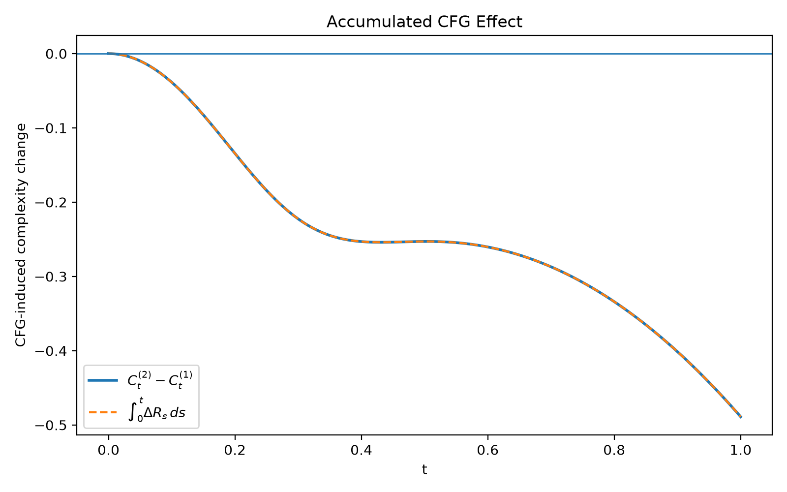

# Mapping Complexity over the CFG Family

> **Can classifier-free guidance (CFG) make a flow map geometrically simpler, even when there is no neural velocity-estimation error?**

This repository studies that question in an analytic 2D toy setting.
처음에는 **CFG가 induced re-mapping을 contraction시키기 때문에 mapping complexity가 감소할 것**이라고 예상했다. 실험을 진행하면서 global contraction만으로는 충분한 설명이 아니라는 것을 확인했고, 최종적으로는 **velocity-gradient와 accumulated deformation의 시간적 상호작용**까지 내려가 CFG의 효과를 분석했다.

### At a glance

| | |
|---|---|
| **Question** | CFG가 velocity-network error와 별개로 flow map 자체를 simpler하게 만드는가? |
| **Finding** | 이 toy에서는 CFG scale이 증가할수록 flow-map complexity가 크게 감소했다. |
| **Mechanism** | 단순한 uniform contraction이 아니라, instantaneous stretching과 accumulated deformation geometry의 interaction이 complexity evolution을 결정했다. |

핵심적인 complexity dynamics는 다음과 같다.

$$
\frac{d}{dt}\mathcal{C}_t
=
2\,\mathbb{E}
\left[
\mathrm{tr}(S_tM_t)
\right],
\qquad
M_t=J_tJ_t^\top
$$

---

## Research Progression

```text
Exp 1   CFG-induced re-mapping이 contraction하는가?
  ↓
Exp 2   identity-direction degeneracy를 제거하면 strict contraction이 나타나는가?
  ↓
Exp 3   실제 flow-map mapping complexity도 감소하는가?
  ↓
Diag.   왜 operator-norm contraction bound는 실제 감소를 잘 설명하지 못하는가?
  ↓
Exp 4   global contraction 없이도 complexity가 감소할 수 있는가?
  ↓
Theory  Jacobian dynamics에서 complexity evolution을 직접 유도
  ↓
Exp 5   final complexity를 결정하려면 어떤 path / transport 정보가 필요한가?
  ↓
Exp 6   실제 CFG의 complexity 감소를 deformation dynamics로 설명할 수 있는가?
```

초기의 질문은

> **“CFG는 contraction을 만드는가?”**

였지만, 최종적으로는

> **“어떤 velocity/deformation history가 low-complexity flow map을 만드는가?”**

로 바뀌었다.

---

# I. Testing the Contraction Hypothesis

## Exp 1 — CFG-Induced Re-Mapping Contraction

**Question.** CFG를 강하게 하면 induced re-mapping $g_\omega$가 contraction하는가?

CFG flow와 unguided flow 사이의 data-to-data re-mapping을 다음과 같이 두었다.

$$
g_\omega
=
f^{(\omega)}\circ f^{-1}
$$

**Finding.** 한 방향에서는 contraction이 나타났지만, 다른 방향이 identity로 남아 있어 operator norm은 1이었다.

> **Next →** CFG의 contraction이 보이지 않은 이유가 단순한 identity-direction degeneracy 때문인지 확인한다.

---

## Exp 2 — Removing the Identity-Direction Degeneracy

**Question.** Exp 1의 결과가 toy의 identity direction 때문에 생긴 특수한 현상인가?

Class covariance를 anisotropic하게 바꾸어 Exp 1에서 남아 있던 identity direction을 제거했다.

**Finding.** $\omega>1$에서 sampled region의 local operator norm이 1보다 작아졌다. 즉, 이 toy에서는 CFG가 **strict local contraction**을 만들 수 있었다.

다만 이것은 sampled local result이며 global contraction의 증명은 아니다.

> **Next →** 그렇다면 이 contraction이 실제 flow-map complexity 감소로 이어지는가?

---

## Exp 3 — Mapping Complexity over the CFG Family

**Question.** CFG를 강하게 할수록 실제 flow map도 더 simple해지는가?

Mapping complexity를 다음과 같이 측정했다.

$$
\mathcal{C}(f^{(\omega)})
=
\mathbb{E}_z
\left[
\left\|
\nabla f^{(\omega)}(z)
\right\|_F^2
\right]
$$

| CFG scale $\omega$ | Mapping complexity |
|---:|---:|
| 1.0 | 1.2500 |
| 1.5 | 0.8957 |
| 2.0 | 0.7611 |
| 3.0 | 0.6376 |
| 4.0 | 0.5768 |

**Finding.** CFG scale이 증가할수록 mapping complexity가 크게 감소했다.

> **Key point.** 이 실험에서는 analytic marginal velocity를 사용했기 때문에 neural velocity estimator가 개입하지 않는다. 따라서 적어도 이 toy에서 관찰된 CFG의 이득은 **velocity-network approximation error만으로 설명할 수 없다.**

### Why is the operator-norm explanation loose?

Exp 1–2의 contraction과 Exp 3의 complexity reduction을 연결하면 다음 upper bound를 생각할 수 있다.

$$
\|GF\|_F^2
\le
\|G\|_{\mathrm{op}}^2
\|F\|_F^2
$$

이 bound 자체는 맞지만 실제 감소를 설명하기에는 상당히 loose했다.

Directional diagnostic을 해보면 이유가 드러난다. **모든 input-space direction이 reference flow map $f$의 mapping complexity에 똑같이 기여하지 않기 때문**이다.

Reference Jacobian energy가 많이 실린 방향은 CFG에 의해 강하게 contract하고 있었고, energy가 적게 실린 방향은 상대적으로 약하게 contract하고 있었다.

> 중요한 것은 **“가장 덜 contract한 방향이 무엇인가?”**가 아니라,
> **“reference flow의 Jacobian energy가 많이 실린 방향이 어떻게 변하는가?”**였다.

> **Next →** 일부 방향이 expand하더라도 high-energy direction이 충분히 contract하면 전체 complexity는 감소할 수 있는가?

---

## Exp 4 — Contraction / Mapping Complexity Decoupling

**Question.** Global contraction 없이도 mapping complexity가 감소할 수 있는가?

Mean-level에서 미리 정의한 강한 decoupling criterion은 성립하지 않았다. 하지만 individual samples에서는 실제 decoupling이 나타났다.

**Finding.** Decoupled sample들은 공통적으로 다음 구조를 보였다.

| Direction | Behavior |
|---|---|
| **Low-weight direction** | Expansion |
| **High-weight direction** | Contraction |

즉, 어떤 방향에서는 expansion이 존재해도 reference Jacobian energy가 많이 실린 방향이 충분히 contract하면 전체 Frobenius complexity는 감소할 수 있었다.

> **Exp 1–4 conclusion.** CFG-induced contraction은 실제 현상이지만, **global contraction은 mapping-complexity reduction을 설명하기에는 너무 강한 조건**이다.

이 지점에서 질문을 한 단계 앞쪽으로 옮겼다.

**이미 만들어진 flow map의 Jacobian을 비교하는 대신, 그 Jacobian 자체가 velocity field로부터 어떻게 만들어지는지를 보자.**

---

# II. From Contraction to Jacobian Dynamics

## Where does mapping complexity come from?

Flow trajectory가

$$
\frac{dx_t}{dt}
=
v_t(x_t)
$$

를 따른다면, flow Jacobian $J_t$는

$$
\frac{dJ_t}{dt}
=
\nabla_x v_t(x_t)J_t
$$

를 따른다.

즉, **velocity가 공간의 위치에 따라 얼마나 달라지는지가 시간이 지나면서 flow map의 local deformation을 만들어낸다.**

Velocity Jacobian의 symmetric part를

$$
S_t
=
\frac{
\nabla v_t+\nabla v_t^\top
}{2}
$$

라고 하면,

$$
\frac{d}{dt}\|J_t\|_F^2
=
2\,\mathrm{tr}
\left(
S_tJ_tJ_t^\top
\right)
$$

를 얻는다.

여기서

$$
M_t
=
J_tJ_t^\top
$$

라고 두면 population-level mapping complexity의 변화는

$$
\frac{d}{dt}\mathcal{C}_t
=
2\,\mathbb{E}
\left[
\mathrm{tr}(S_tM_t)
\right]
$$

로 정리된다.

| Quantity | Interpretation |
|---|---|
| $S_t$ | 현재 velocity field가 만드는 **instantaneous signed stretching / contraction** |
| $M_t$ | 그 시점까지 flow가 누적해 온 **deformation geometry** |

따라서 mapping complexity는 단순히 현재 velocity gradient의 크기로 결정되는 것이 아니다.

> **Mapping complexity evolves through the alignment between instantaneous signed stretching and accumulated deformation geometry.**

### Can we remove the full flow Jacobian?

여기서 새로운 문제가 생긴다. Exact dynamics의 오른쪽에도 여전히 $M_t=J_tJ_t^\top$가 남아 있다.

즉, exact mapping complexity를 계산하려면 결국 flow의 deformation history를 알아야 한다.

그래서 다음 질문은 다음과 같았다.

> **Can flow-map complexity be predicted or controlled from path-level velocity geometry without explicitly constructing the full flow map?**

1D, fixed-direction 2D, rotating 2D를 순서대로 생각해보면 단순한 $S_t$-only scalar summary가 일반적인 directional history를 보존하기 어렵다는 점이 드러난다.

또한 $M_t$의 top-energy direction 하나만 남기는 rank-1 approximation도 실제 complexity change를 제대로 복원하지 못했다.

> **Next →** probability path, transport coupling, velocity statistics가 각각 final mapping complexity를 얼마나 결정하는지 분리해서 확인한다.

---

# III. What Information Is Actually Necessary?

## Exp 5 — Boundary Tests

Exp 5는 하나의 새로운 proxy를 억지로 정의하는 대신, **final mapping complexity를 결정하는 데 어떤 정보가 실제로 충분한지**를 네 가지 boundary test로 확인했다.

| Test | What changed? | What happened? | What it tells us |
|---|---|---|---|
| **Exp 5-A** | Rotating linear-Gaussian path | Final complexity unchanged | 일부 family에서는 endpoint covariance가 complexity를 구조적으로 고정한다. |
| **Exp 5-B** | Transport coupling, with the same marginal path | Final complexity changed | **Marginal probability path alone is insufficient.** |
| **Exp 5-C** | Velocity information compressed to simple scalars | Trace-based statistic gave the wrong ordering | Low-information summaries can lose essential deformation geometry. |
| **Exp 5-D** | Intermediate probability path | Final complexity was essentially invariant in the tested family | Different probability paths do not necessarily imply different complexity. |

### What Exp 5 means

Exp 5-A는 모든 toy family가 interpolation-dependent complexity를 연구하기에 적합한 것은 아니라는 점을 보여주었다.

Exp 5-B는 **동일한 marginal probability path라도 transport coupling이 다르면 final complexity가 달라질 수 있음**을 보여주었다.

Exp 5-C는 velocity field의 단순한 scalar statistic만으로는 contraction/expansion의 방향과 accumulated deformation energy의 관계를 잃을 수 있음을 보여주었다.

Exp 5-D는 반대로 **probability path가 달라졌다는 사실만으로 final complexity 변화가 보장되지는 않음**을 보여주었다.

> **Exp 5 conclusion.** Final mapping complexity는 endpoint, marginal probability path, 또는 단순한 scalar velocity statistic만으로 일반적으로 결정되지 않는다. 중요한 것은 그 설정이 실제로 유도하는 **transport / deformation history**이다.

이제 마지막으로 처음의 CFG 문제로 돌아갈 수 있다.

---

# IV. Direct CFG Mechanism

## Exp 6 — How Does CFG Actually Lower Complexity?

**Question.** CFG가 실제로 final mapping complexity를 낮추는 과정도 위의 deformation dynamics로 설명할 수 있는가?

$\omega=1$과 $\omega=2$를 직접 비교했다.

| | $\omega=1$ | $\omega=2$ |
|---|---:|---:|
| **Final complexity** | 1.2500 | **0.7611** |

Final difference는 약 $-0.48887$이었다.

Exact complexity rate를

$$
R_t
=
2\,\mathbb{E}
\left[
\mathrm{tr}(S_tM_t)
\right]
$$

라고 하면,

$$
\mathcal{C}_1^{(2)}
-
\mathcal{C}_1^{(1)}
=
\int_0^1
\left(
R_t^{(2)}-R_t^{(1)}
\right)dt
$$

가 numerical integration error 범위에서 성립했다.

### What actually happened?

| Phase | CFG effect |
|---|---|
| **Early** | Complexity를 더 강하게 감소시켰다. |
| **Transition** | Complexity-decreasing phase가 더 오래 지속되었다. |
| **Late** | Re-expansion은 발생했지만 unguided flow보다 약했다. |

따라서 CFG가 모든 시간에서 더 contractive했던 것은 아니다.

> **CFG lowers final complexity through stronger early complexity decrease and delayed / weaker late re-expansion.**

즉, 최종 complexity 감소는 uniform contraction의 결과가 아니라 **전체 시간에 걸쳐 달라진 deformation history의 누적 결과**였다.

---

# Final Takeaway

### Initial hypothesis

```text
CFG -> contraction -> lower mapping complexity
```

### Refined mechanism

```text
CFG
 -> changes velocity-gradient geometry
 -> changes its interaction with accumulated deformation
 -> changes the time-integrated complexity rate
 -> produces a lower-complexity final flow map
```

이 프로젝트의 핵심 연결은 다음과 같다.

$$
\text{interpolation / transport}
\rightarrow
v_t
\rightarrow
\nabla v_t
\rightarrow
J_t
\rightarrow
\mathcal{C}(f)
$$

그리고 complexity evolution은

$$
\frac{d}{dt}\mathcal{C}_t
=
2\,\mathbb{E}
\left[
\mathrm{tr}(S_tM_t)
\right]
$$

로 주어진다.

> **In this analytic 2D toy, CFG genuinely lowers flow-map complexity independently of neural velocity-estimation error. The mechanism is not uniform contraction, but the time-dependent interaction between instantaneous signed stretching and accumulated deformation geometry.**

---

## Main Figures

<p align="center">
  
  
</p>

<p align="center">
  
  
</p>

---

## Scope

이 프로젝트는 **analytic 2D toy setting에서 CFG와 flow-map geometry 사이의 mechanism을 분리해서 살펴본 exploratory study**이다.

여기서 사용한 Jacobian complexity는 geometric mapping-complexity measure이다. 따라서

> **lower Jacobian complexity = lower neural-network learning difficulty**

라고 바로 결론내릴 수는 없다.

실제 finite-capacity neural network에서 낮은 mapping complexity가 approximation 또는 learning difficulty 감소로 이어지는지는 별도의 검증 문제이다.

---

## Repository

```text
cfg-flow-complexity/
├── experiments/       # Exp 1-6 experiment scripts
├── src/               # distributions, velocity fields, flow integration, re-mapping
├── results/           # numerical outputs
└── results/figures/   # generated figures
```

### Run

```bash
source .venv/bin/activate
python -m experiments.exp03_mapping_complexity
python -m experiments.exp06_cfg_mechanism
```

**Status:** Core exploratory experiments completed through Exp 6.
